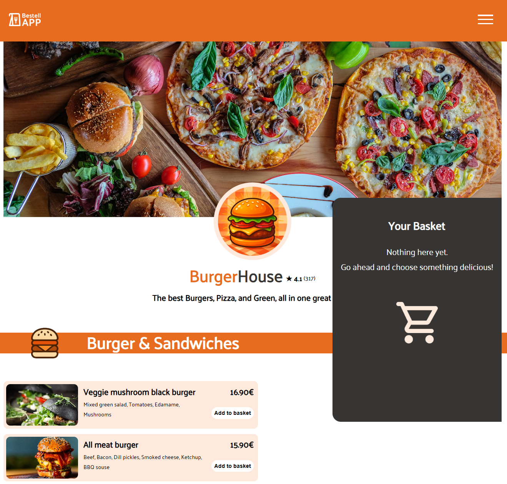
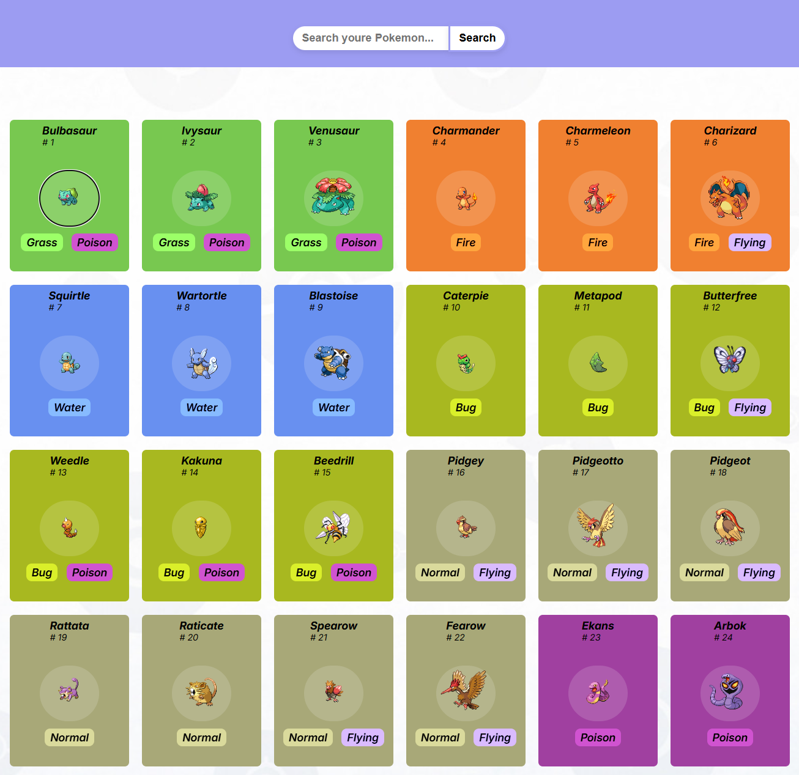

# Hi, I'm Maximilian 👋
 

## About me
I'm currently studying Computer Science and improving my development skills
 

 ## Projects
 <table align="center">
   <tr>
     <td >
      <h3>Order App</h3>
      
        
      
      
         
      
Food ordering interface built with JavaScript and HTML/CSS.

         
     </td>
     <td>
      <h3>Pokedex</h3>
      
        
      
      
         
      
Pokedex built with JavaScript and API integration.

         
     </td>
    </tr>
 </table>
👉 Check out my repositories for more projects
  

## 🛠️ Tech Stack
 

**Languages**

  
  
  
  
  
  
  
  
  
  
  

 

**Tools**

## GitHub Activity

  

 ## Contact
  
  <h3>Feel free to check out my repositories or connect with me.</h3>

